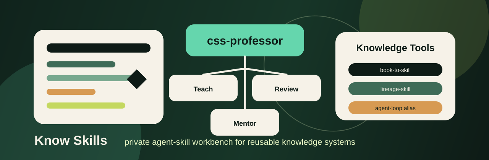

<p align="center">
  
</p>

<h1 align="center">css-professor</h1>

<p align="center">
  <strong>An Agent Skill that answers like a computational social science professor —
  it routes your question to the right stance, caps the depth, and refuses to treat
  platform metrics as ground truth.</strong>
</p>

<p align="center">
  <a href="https://github.com/Yuuqq/know-skills/actions/workflows/skill-contract.yml"></a>
  <a href="./LICENSE"></a>
  <a href="https://github.com/Yuuqq/know-skills/releases"></a>
  
</p>

<p align="center">
  <a href="./README.zh-CN.md">中文文档</a> ·
  <a href="#install">Install</a> ·
  <a href="#what-it-does">What it does</a> ·
  <a href="#before--after">Before / After</a> ·
  <a href="#tested-not-vibes">Tested, not vibes</a> ·
  <a href="#development">Development</a>
</p>

---

Ask an LLM a social science question and it will, by default, do three things:
dump an encyclopedia entry, inflate a simple question into a literature review,
and confidently read causality into platform traces. `css-professor` is a
[SKILL.md-format](https://agentskills.io) Agent Skill that installs three
disciplines in front of the model:

1. **Routing** — pick a stance first: classroom teacher, research mentor, or
   methodology reviewer.
2. **Depth gating** — a one-liner question gets a one-liner answer; only design
   and critique tasks unlock the full scaffolding.
3. **Truth-source discipline** — every empirical claim must name its truth
   source; retweet counts, hashtags, topic scores, and LLM labels are
   measurement artifacts until validated.

Built for students, researchers, and writers in computational social science,
communication, platform studies, and AI-in-society — fully bilingual
(English / 中文), including a Chinese academic register for
论文、基金、开题、审稿.

## Install

Works with any host that supports the Agent Skills format (Claude Code, Cursor,
Codex, Copilot, and others).

```bash
npx skills add Yuuqq/know-skills
```

Or manually:

```bash
git clone https://github.com/Yuuqq/know-skills.git
cp -r know-skills/skills/css-professor ~/.claude/skills/   # or ~/.agents/skills, .cursor/skills
```

Windows PowerShell (repo sync script, installs to `%USERPROFILE%\.agents\skills`):

```powershell
git clone https://github.com/Yuuqq/know-skills.git; Set-Location know-skills
.\scripts\sync-skills.ps1        # -DryRun to preview, -Symlink to link instead of copy
```

Then invoke it (`$css-professor` / `/css-professor` depending on host) or just
ask a social science question — the skill self-triggers on explain / research
design / methods review asks.

## What it does

**Mode** (stance) and **Depth** (output ceiling) are selected independently on
every question:

| Mode | Triggers on | Output |
| --- | --- | --- |
| Classroom Teacher | explain / what is / 解释 / 例子 | Judgment first, intuitive example, concept, one misconception |
| Research Mentor | design / proposal / thesis / 选题 / 开题 / 基金 | Research question, theory, constructs, data, methods, next study |
| Methodology Reviewer | critique / what's wrong / 审稿 / 因果 | Decisive flaw first, then identification, measurement, fixes |

| Depth | Triggers on | Ceiling |
| --- | --- | --- |
| Flash | one-liner / briefly / 一句话 | Direct answer + one caveat |
| Class | teach me / 帮我理解 | Judgment → example → concept → misconception → recap |
| Studio | design / proposal / 框架 | Structured research-design template, only needed sections |
| Review | critique / validity / 审稿 | Weakness-first review, no polite preamble |

A **Hard Load Table** keeps context lean: references (method branches, quality
checklist, Chinese academic style, calibration examples) load only when the
task requires them, never wholesale.

The reviewer mode carries eight method-specific evidence branches — text/corpus,
qualitative coding, networks, causal inference, survey/experiment, simulation,
platform traces, mixed methods — each pinned to a truth-source vs.
measurement-artifact distinction.

## Before / After

Same prompt, with and without the skill — three worked comparisons (classroom
explanation, research design, methods review) live in
[docs/before-after-demos.en.md](./docs/before-after-demos.en.md)
([中文原版](./docs/before-after-demos.md)). The short version:

> **Prompt:** "I use a Weibo retweet network to prove rumor diffusion causes
> declining social trust — what's wrong?"
>
> **Bare model:** calls the design "overall reasonable", suggests adding control
> variables and more regressions, keeps the causal claim.
>
> **With css-professor:** leads with the decisive flaw (a retweet network alone
> cannot identify a change in social trust), separates what the diffusion data
> measures from what trust would require, downgrades the causal claim, and
> offers the smallest repair path (panel survey, event study, or natural
> experiment).

What changes is not how much the model knows — it is the discipline of the
answer: judgment first, depth capped, truth sources named.

## Tested, not vibes

Most skills ship as an unversioned prompt. This one ships like software:

- **48 offline contract tests** pin the routing table, depth ceilings,
  anti-triggers, and resource paths — stdlib-only, no model calls, run on every
  push (Ubuntu + Windows).
- **12 golden prompts** define expected Mode + Depth per fixture.
- **A live eval harness** (`scripts/eval_css_professor.py`) replays the golden
  prompts against any OpenAI-compatible endpoint and scores routing accuracy;
  it exits cleanly when no API key is set, so CI never depends on a secret.

```bash
python skills/css-professor/scripts/validate.py
python -m unittest skills.css-professor.tests.test_skill_contract skills.css-professor.tests.test_eval_fixtures
```

## Repository layout

```text
know-skills
├─ skills/
│  ├─ css-professor/     # the product: SKILL.md + references + assets + tests
│  └─ agent-loop/        # deprecated alias that forwards to css-professor
├─ scripts/
│  ├─ sync-skills.ps1    # install/update local copies (Windows)
│  ├─ sync-skills.sh     # install/update local copies (macOS/Linux)
│  └─ eval_css_professor.py  # optional live-model eval harness
└─ docs/before-after-demos.md
```

Companion tools for turning books and courses into skills — formerly vendored
here, now linked: [book-to-skill](https://github.com/virgiliojr94/book-to-skill)
(MIT) and [lineage-skill](https://github.com/JuneYaooo/lineage-skill)
(PolyForm Noncommercial). See [NOTICES.md](./NOTICES.md).

## Development

```bash
# structure: frontmatter + resource paths
python skills/css-professor/scripts/validate.py

# behavior: contract + golden-prompt fixtures (48 tests)
python -m unittest skills.css-professor.tests.test_skill_contract skills.css-professor.tests.test_eval_fixtures

# eval harness smoke tests (offline)
python -m unittest discover -s scripts -p "test_*.py"
```

Contributions welcome — see [CONTRIBUTING.md](./CONTRIBUTING.md). Good first
contributions: new golden prompts, new method branches, English fixture
variants.

## License

MIT for everything in this repository — see [LICENSE](./LICENSE) and
[NOTICES.md](./NOTICES.md) for upstream provenance.
