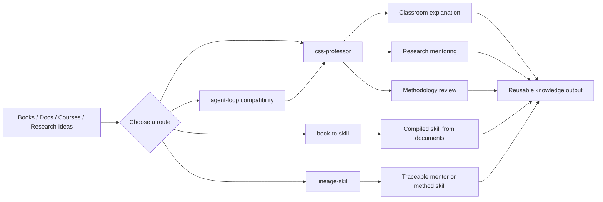
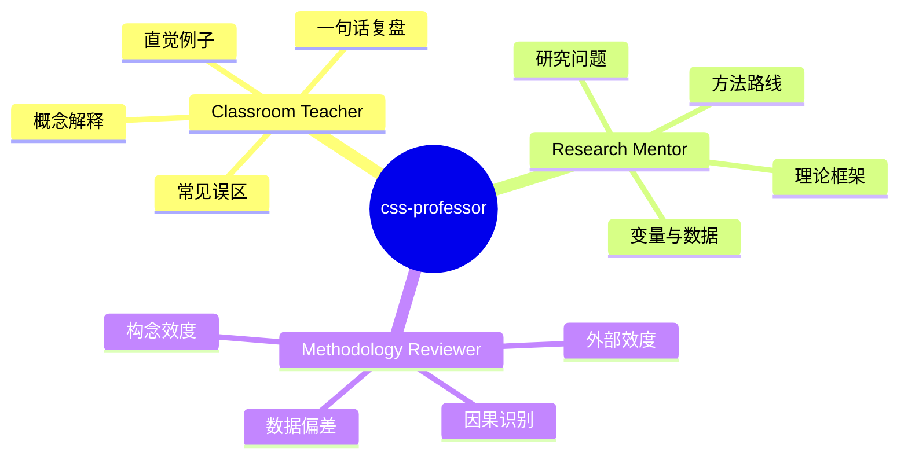
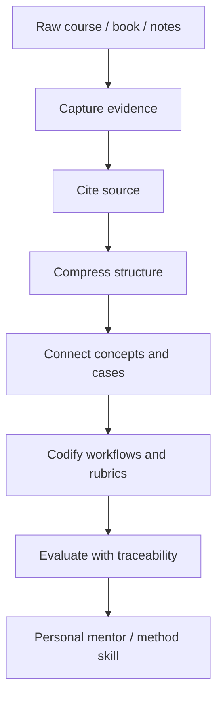
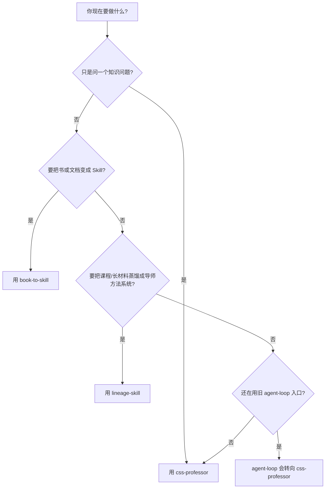

<p align="center">
  
</p>

<h1 align="center">Know Skills</h1>

<p align="center">
  <strong>给做计算社会科学、传播学、平台研究与学术方法的人 —— 一个能像教授那样解释、带研究、审稿的 Agent Skill。</strong>
</p>

<p align="center">
  核心 <code>css-professor</code>：课堂科普老师 / 研究型导师 / 方法论审稿人，按问题类型自动路由，强制"真值来源 vs 测量产物"纪律。
</p>

<p align="center">
  
  
  
</p>

<p align="center">
  <a href="#这是什么">这是什么</a> ·
  <a href="#为什么比裸-prompt-好用">为什么比裸 prompt 好用</a> ·
  <a href="#快速开始">快速开始</a> ·
  <a href="#核心技能css-professor">css-professor</a> ·
  <a href="#还有这些工具">还有这些工具</a> ·
  <a href="#维护流程">维护流程</a>
</p>

<p align="center">
  <a href="#这是什么">这是什么</a> ·
  <a href="#仓库地图">仓库地图</a> ·
  <a href="#核心技能">核心技能</a> ·
  <a href="#快速开始">快速开始</a> ·
  <a href="#典型用法">典型用法</a> ·
  <a href="#维护流程">维护流程</a>
</p>

---

## 这是什么

这个仓库的核心产品是 **`css-professor`** —— 一个 Agent Skill，让 AI 像一位计算社会科学教授那样回答你：先判断这是哪类知识问题，再选合适的姿态和深度，并守住"别把相关当因果、别把平台痕迹当真值"的学术纪律。

它适合的人：

| 你是 | 它替你拦住的毛病 |
| --- | --- |
| 学生 / 自学者 | 解释停在百科铺陈，没有一句话判断和直觉例子 |
| 正在选题 / 开题 / 写基金的人 | 把泛泛题目当研究问题，构念没拆，机制没分 |
| 做实证 / 审稿的人 | 因果过度自信，把转发量、话题标签、LLM 分数当成真值 |

**给谁、解决什么**：给做计算社科、传播、平台、组织行为、AI-in-society 研究和写作的人；把"AI 默认会犯的学术过度自信"用三道纪律（路由 + 深度门控 + 真值来源）拦掉。

### 为什么比裸 prompt 好用

裸 prompt 问同一个问题，模型默认会犯三类错：百科式堆砌、把简单问题升成综述、把痕迹当因果。`css-professor` 用三刀拦住它们。三组 before/after 对比见：

👉 **[docs/before-after-demos.md](./docs/before-after-demos.md)**（课堂解释 / 研究设计 / 方法审稿，各一组）

一句话总结：它改变的不是"知道多少"，而是**回答的纪律**——先给判断、按深度收口、命名真值来源。

### 仓库里还有什么

`css-professor` 是上架主推的核心。仓库里还带三个辅助资源（详见 [还有这些工具](#还有这些工具)）：

| 资源 | 定位 | 是否默认安装 |
| --- | --- | --- |
| `agent-loop` | 旧调用名的兼容入口，已重定向到 `css-professor` | 随核心一起装（仅为兼容老提示词） |
| `book-to-skill-master/` | 上游工具：把书 / 文档转成 Skill | 可选，vendored 副本（见 [许可说明](#许可说明)） |
| `lineage-skill-main/` | 上游工具：把课程 / 长材料蒸馏成方法系统 | 可选，vendored 副本 |

目标读者：做社科 / 传播 / 平台研究的学生、研究者、写作者，以及任何想给 AI 加上"教授式回答纪律"的人。读完本文后，应能把 `css-professor` 装进本地 Agent 环境，并知道它和不装的区别。

---

## 仓库地图

```text
know-skills
├─ skills
│  ├─ css-professor        # 主力知识技能：教授式解释、研究指导、方法审稿
│  └─ agent-loop           # 兼容入口：旧调用名转向 css-professor
├─ scripts
│  ├─ sync-skills.ps1      # 同步核心技能到本机 Agent skills 目录
│  └─ sync-skills.sh
├─ .github/workflows
│  └─ skill-contract.yml   # validate + unittest + sync dry-run
├─ book-to-skill-master    # 上游工具：书籍/文档 -> Agent Skill
├─ lineage-skill-main      # 上游工具：课程/书籍/长材料 -> 可溯源方法系统
└─ docs
   └─ assets               # README 图示资源
```



---

## 核心技能：css-professor

`css-professor` 是本仓库当前最重要的定制技能。它的定位是“计算社会科学教授型任意知识工具”，但不会把所有问题都硬套成计算社会科学。它会先判断知识类型，再选择合适视角。



| 模式 | 什么时候用 | 输出重点 |
| --- | --- | --- |
| 课堂科普老师 | “解释一下”“我没懂”“用例子说明” | 先讲直觉，再给概念，再指出误区 |
| 研究型导师 | “帮我设计研究”“这个选题怎么做” | 研究问题、理论机制、构念、数据、方法、贡献 |
| 方法论审稿人 | “这个设计有什么问题”“帮我审稿” | 最关键缺陷、识别策略、测量问题、修复方案 |

它还包含两类辅助资源：

| 资源 | 作用 |
| --- | --- |
| 教授式回答模板 | 规范长回答的结构：判断、概念、机制、证据、风险、下一步 |
| 质量审查清单 | 防止泛泛而谈、概念混淆、过度因果、平台数据误读 |
| 示例库 | 校准不同问题应该触发哪种教授模式 |
| 中文学术风格规范 | 适配中文论文、基金、课堂讲义、研究计划和方法审查 |

---

## 还有这些工具

下面三个不是核心产品，是随仓库一起带的辅助资源。新用户通常不需要第一时间装它们。

### Agent Loop 兼容入口

`agent-loop` 原本是 loop 契约设计技能。现在它已被改成兼容入口：当你仍然用旧名字调用时，它会转向 `css-professor` 的教授型知识工具，而不是继续默认输出 `loop.md`。

> 新用户可忽略。保留它只是为了不破坏已经在用 `$agent-loop` 的老提示词。

### Book To Skill（上游 vendored 副本）

`book-to-skill` 用来把书籍、PDF、EPUB、DOCX、Markdown、HTML、RTF 等资料转成可安装的 Agent Skill。它适合处理“我经常会回头用，但不想每次重新读”的材料。

典型场景：

| 输入 | 目标 |
| --- | --- |
| 技术书 | 生成可查询的章节、术语、模式和速查表 |
| 内部文档 | 变成项目知识技能，减少反复搜索 |
| 论文簇 | 合并成一个领域参考技能 |
| 标准/规范 | 在写代码或写文档时按需调用 |

### Lineage Skill（上游 vendored 副本）

`lineage-skill` 面向更重的“课程/书籍/长文档方法系统蒸馏”。它不只是总结内容，而是把老师或作者的方法拆成可复用的判断框架、流程、模板、质量标准和失效条件。



---

## 快速开始

### 1. 克隆仓库

```powershell
git clone https://github.com/Yuuqq/know-skills.git
Set-Location know-skills
```

### 2. 安装本仓库的定制技能

仓库里有两类技能：

- **核心定制技能**（`skills/css-professor`、`skills/agent-loop`）：仓库自己维护、可直接安装。
- **上游工具技能**（`book-to-skill-master/`、`lineage-skill-main/`）：第三方项目的 vendor 副本，作为"参考源码 + 可选安装"保留，不在快速开始里默认安装。

#### 2a. 核心技能（推荐）

用仓库自带同步脚本（推荐）：

```powershell
.\scripts\sync-skills.ps1
# 预览： .\scripts\sync-skills.ps1 -DryRun
# 符号链接（需开发者模式/管理员）： .\scripts\sync-skills.ps1 -Symlink
```

```bash
./scripts/sync-skills.sh
# ./scripts/sync-skills.sh --dry-run
# ./scripts/sync-skills.sh --symlink
```

默认安装到 `$HOME/.agents/skills`（Windows 为 `%USERPROFILE%\.agents\skills`）。可用环境变量 `SKILLS_ROOT` 覆盖目标目录。

等价手写 PowerShell：

```powershell
$skillsRoot = "$env:USERPROFILE\.agents\skills"
New-Item -ItemType Directory -Force $skillsRoot | Out-Null
Copy-Item -Recurse -Force ".\skills\css-professor" "$skillsRoot\css-professor"
Copy-Item -Recurse -Force ".\skills\agent-loop" "$skillsRoot\agent-loop"
```

#### 2b. 上游工具技能（可选）

`book-to-skill` 和 `lineage-skill` 是处理"书 / 课程 / 长文档"的工具型技能。它们的 SKILL.md 会通过相对路径调用各自 `scripts/` 下的 Python 脚本（如 `book-to-skill` 的 `scripts/extract.py`、`lineage-skill` 的 `scripts/run_course_pipeline.py`），所以**安装时必须带上 `scripts/` 和 `references/`**，不能只拷 SKILL.md。

PowerShell（按需二选一或都装）：

```powershell
$skillsRoot = "$env:USERPROFILE\.agents\skills"
New-Item -ItemType Directory -Force $skillsRoot | Out-Null

# book-to-skill：PDF/EPUB/DOCX/Markdown/HTML/RTF -> Agent Skill
Copy-Item -Recurse -Force ".\book-to-skill-master\SKILL.md" "$skillsRoot\book-to-skill\SKILL.md"
Copy-Item -Recurse -Force ".\book-to-skill-master\scripts"  "$skillsRoot\book-to-skill\scripts"
Copy-Item -Recurse -Force ".\book-to-skill-master\tools"    "$skillsRoot\book-to-skill\tools"

# lineage-skill：课程/书籍/视频/讲义 -> 可溯源导师方法系统
Copy-Item -Recurse -Force ".\lineage-skill-main\SKILL.md"     "$skillsRoot\lineage-skill\SKILL.md"
Copy-Item -Recurse -Force ".\lineage-skill-main\references"   "$skillsRoot\lineage-skill\references"
Copy-Item -Recurse -Force ".\lineage-skill-main\scripts"      "$skillsRoot\lineage-skill\scripts"
Copy-Item -Recurse -Force ".\lineage-skill-main\agents"       "$skillsRoot\lineage-skill\agents"
Copy-Item -Recurse -Force ".\lineage-skill-main\requirements.txt" "$skillsRoot\lineage-skill\requirements.txt"
```

> `lineage-skill` 需要按 `lineage-skill-main/requirements.txt` 装 Python 依赖，并在 `.env` 里配置音频转写 / 视觉分析 / 文本蒸馏的 API 凭证（参考 `lineage-skill-main/.env.example` 和 `references/runtime.md`）。`book-to-skill` 会在首次运行时按需提示安装解析依赖。

#### 2c. 来源与许可说明

`book-to-skill-master/` 和 `lineage-skill-main/` 是各自上游开源项目的完整副本（含 `LICENSE.md` / `LICENSE`、`README.md`、`tests/`），仓库没做侵入式改动。升级时优先以上游为准；本仓库只随核心技能一起演进。

### 3. 验证技能文件

零依赖结构校验（frontmatter + 资源路径）：

```powershell
python .\skills\css-professor\scripts\validate.py
```

行为契约 + 离线黄金题（不调模型）：

```powershell
python -m unittest skills.css-professor.tests.test_skill_contract skills.css-professor.tests.test_eval_fixtures -v
```

输出形如：

```text
OK  css-professor: frontmatter + resources valid
OK  agent-loop: frontmatter + resources valid

All skills valid.
```

推送到 GitHub 后，`.github/workflows/skill-contract.yml` 会在改动 `skills/**` 时自动跑上述检查。

---

## 典型用法

### 用 CSS Professor 做课堂解释

```text
$css-professor
用课堂上能听懂的方式解释：为什么算法推荐会改变公共讨论？
```

预期结果：

- 先给一句话判断。
- 用生活化例子解释直觉。
- 再给计算社会科学视角的机制。
- 最后指出一个常见误区。

### 用 CSS Professor 做研究指导

```text
$css-professor
我想研究短视频平台对大学生政治参与的影响，帮我设计研究问题和方法路线。
```

预期结果：

- 拆分政治兴趣、政治知识、政治效能感、线上参与、线下参与。
- 区分“选择效应”和“影响效应”。
- 给出最低可行研究设计和更强的替代设计。
- 标出数据、因果识别和外部效度风险。

### 用 CSS Professor 做方法审稿

```text
$css-professor
我用微博转发网络证明谣言扩散会导致社会信任下降，这个设计有什么问题？
```

预期结果：

- 直接指出转发网络无法单独识别社会信任下降。
- 区分谣言扩散测量和社会信任测量。
- 给出可修补路径，例如调查、面板、事件研究或自然实验。
- 降级不被设计支持的因果结论。

### 用 Book To Skill 处理书籍和文档

```text
请用 book-to-skill 把这组论文和笔记整理成一个可调用的领域 Skill。
```

适合资料：

- 单本书。
- 多篇论文。
- 项目文档。
- 反复查阅的规范、手册、课程讲义。

### 用 Lineage Skill 处理课程和方法系统

```text
请用 lineage-skill 把这套课程整理成一个可溯源、可迁移、可产出的导师 Skill。
重点抽取诊断规则、工作流程、质量标准、模板和常见误用。
```

适合资料：

- 视频课、音频课。
- 讲义、截图、OCR 文档。
- 课程笔记和书籍章节。
- 需要长期陪练和产出模板的方法体系。

---

## 如何选择工具



| 你的需求 | 推荐入口 |
| --- | --- |
| 解释一个概念 | `css-professor` |
| 把泛泛选题改成研究问题 | `css-professor` |
| 审查因果识别或测量设计 | `css-professor` |
| 把书转成可查询 Skill | `book-to-skill` |
| 把课程转成导师/方法系统 | `lineage-skill` |
| 旧提示词还在调用 `agent-loop` | 保留使用，自动兼容 |

---

## 维护流程

### 同步本地运行技能

这个仓库保存的是可移植副本。实际 Agent 运行时通常读取用户目录下的技能目录。修改仓库后同步：

```powershell
.\scripts\sync-skills.ps1
```

```bash
./scripts/sync-skills.sh
```

### 修改技能后的检查

| 检查项 | 命令 / 目的 |
| --- | --- |
| 结构校验 | `python skills/css-professor/scripts/validate.py` |
| 契约 + 黄金题 | `python -m unittest skills.css-professor.tests.test_skill_contract skills.css-professor.tests.test_eval_fixtures` |
| Mode / Depth / 加载表 | 确认 `SKILL.md` 路由与 `tests/fixtures/golden_prompts.json` 一致 |
| 中文输出规范 | `references/chinese-academic-style.md` 未口号化 |
| 兼容入口 | 旧 `$agent-loop` 仍路由到 `css-professor` |
| 本机生效 | `scripts/sync-skills.ps1` 或 `.sh` |

### 提交和推送

```powershell
git status --short
git add --all
git commit -m "Improve knowledge skill documentation"
git push
```

正式提交时建议使用带决策信息的提交说明，记录为什么改、验证了什么、还有什么没有测。

---

## 当前状态

| 项目 | 状态 |
| --- | --- |
| GitHub 仓库 | `Yuuqq/know-skills`（MIT，自定义技能部分） |
| 主技能 | `css-professor` v1.0.0：Mode + Depth + Hard Load Table |
| 兼容入口 | `agent-loop` 已重定向（仅兼容老调用名） |
| 离线契约 | 48 个 contract / fixture 测试，stdlib-only |
| 真模型评测 | `scripts/eval_css_professor.py`（需 `EVAL_API_KEY`，未进 push gate） |
| 本机同步 | `scripts/sync-skills.ps1`（Windows）/ `sync-skills.sh`（macOS/Linux） |
| CI | ubuntu 契约 + bash 同步 + **Windows PowerShell 同步** + **上游 smoke** |
| before/after 证据 | [docs/before-after-demos.md](./docs/before-after-demos.md) |
| 许可汇总 | [NOTICES.md](./NOTICES.md)（注意：`lineage-skill-main/` 为 PolyForm Noncommercial） |
| 已知限制 | 上游 vendored 副本未跟踪 SHA（见 `UPSTREAM.sha`）；live eval 需手动跑 |


---

## 许可说明

本仓库的**自定义技能**（`skills/css-professor`、`skills/agent-loop`）采用 MIT 协议（见根目录 `LICENSE`）。完整许可与来源汇总见 [NOTICES.md](./NOTICES.md)。

⚠️ **重要**：两个上游 vendored 副本的许可**不同**，公开发布前必须注意：

| 目录 | 许可 | 限制 |
| --- | --- | --- |
| `book-to-skill-master/` | MIT | 宽松，可随仓库再分发 |
| `lineage-skill-main/` | **PolyForm Noncommercial** | **禁止商业用途**；若本仓库以商业方式分发，此目录不可随附 |

如果只发布核心 `css-professor`，可只取 `skills/` 目录，不携带这两个上游副本。两个上游的来源快照见 `UPSTREAM.sha`（下次同步时记录上游 commit）。

私有研究、学习和个人工作流用途通常最安全；如需公开发布由书籍、课程或第三方材料生成的技能，应先确认原材料授权。
